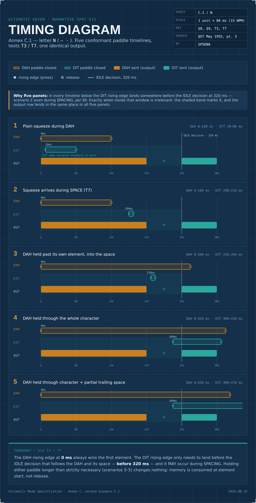
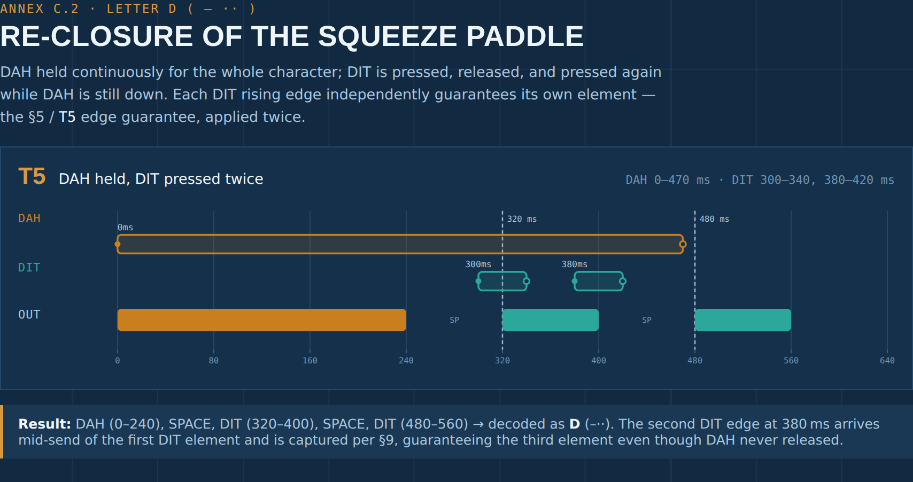
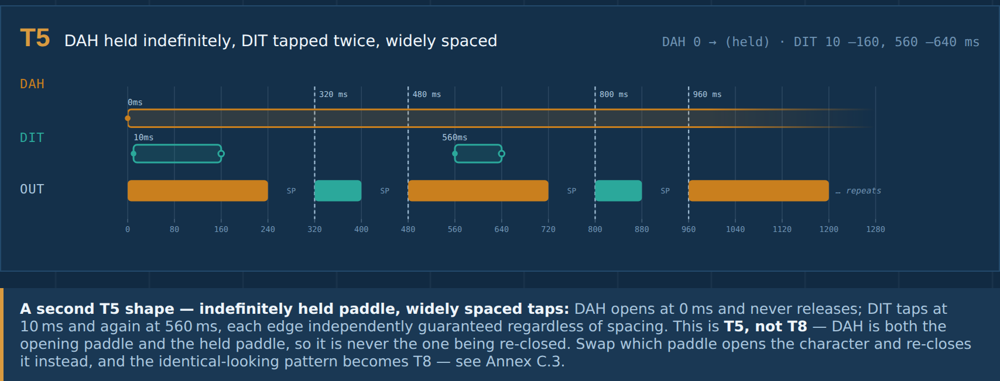
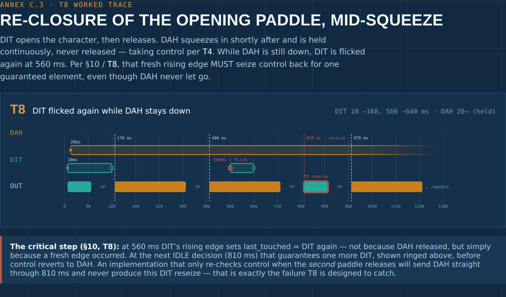

# Ultimatic Mode Specification

A deterministic, implementation-independent specification of **Ultimatic keyer
behavior** for Morse code paddles — detached from any specific hardware,
programming language, or scheduler architecture, with the goal of removing
ambiguity in edge cases and providing testable normative behavior.

## Contents

- [`docs/ULTIMATIC_MODE_SPECIFICATION_UNAMBIGUOUS.md`](docs/ULTIMATIC_MODE_SPECIFICATION_UNAMBIGUOUS.md)
  — the primary normative spec: core requirements (Sections 1–14) plus
  informative annexes (A–D):
  - **Annex A** — the original 1955 source text this spec formalizes, with a
    point-by-point mapping to the normative sections.
  - **Annex B** — reference pseudocode, written so the `last_touched` pointer
    is explicit and live.
  - **Annex C** — three worked timing examples (C.1–C.3), each illustrated
    with a timing diagram (previewed below).
  - **Annex D** — an implementation checklist.

### Annex C previews

**C.1** — Letter N, five conformant paddle timelines converging on one output (`T3`/`T7`)

**C.2** — Letter D, re-closure of the squeeze paddle (`T5`); a second worked example shows the same guarantee holding with an indefinitely-held paddle and widely-spaced taps

**C.3** — the T8 worked trace: re-closure of the *opening* paddle while the squeeze paddle stays down

This repository currently holds the primary spec only. The companion
documents it refers to — a historical draft (`ultimatic_specification.md`)
and an RFC-style conformance checklist
(`ULTIMATIC_MODE_SPECIFICATION_RFC_STYLE.md`) — can be added alongside it in
`docs/` if/when they're ready to publish.

## Why this exists

Most Ultimatic-mode write-ups restate the original 1955 QST description in
prose, which leaves real edge cases ambiguous — most notably **T8**: what
happens when the paddle that *opened* a character is flicked again while the
other paddle is still held down. A naive implementation that only re-checks
control when the *second* paddle releases will pass the common test cases
and still violate the original spec on this exact case. This document exists
to make that requirement — and the rest of the state machine — unambiguous
and testable (see Section 12 for the full conformance suite, T1–T8).

## Status

Normative core (Sections 1–14) + informative annexes (A–D). Issues and pull
requests that identify ambiguity, a failing conformance case, or an
implementation that has been checked against this spec (see the T8 note in
Section 12) are welcome.

## License

Licensed under [CC BY 4.0](LICENSE) — see that file for the full text. You
are free to share and adapt this specification for any purpose, including
implementing it in hardware or software, provided you credit the original
authorship.

Annex A reproduces substantial portions of a 1955 QST Magazine article
("Summary of Actions of the Keys") for traceability between the original
source and the normative requirements it maps to. That article is a
separate, older work reproduced here for reference — see the citation and
link at the top of Annex A. If you plan to redistribute this repository
beyond referencing/quoting it, it's worth independently confirming the
copyright status of that reproduced excerpt; nothing here should be read as
a legal opinion on that point.

## Author

Paweł (SP5DNA) + Claude AI
