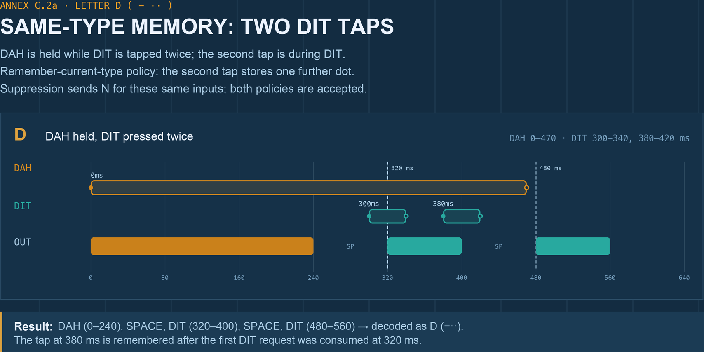

# Ultimatic Mode Specification

**Author:** Paweł (SP5DNA) + Claude AI

**Revision:** 2026-10-20

**Status:** Normative implementation requirements with two accepted current-type re-closure policies (Sections 1–14); informative historical source, examples and checklist (Annexes A–D).

## 1. Purpose

This specification defines deterministic Ultimatic behavior independently of hardware, programming language and scheduler. It preserves squeeze operation: a held first paddle can remain closed while the opposite paddle takes control; releasing the controlling paddle returns output to the other paddle if it is still held and no stored request has precedence.

It defines deterministic implementation requirements, not an electrically exact replica of the 1955 circuit. Section 10.1 accepts two policies for re-pressing the current type: remembering the press or suppressing it. An implementation MUST document its choice. All other core requirements apply to both policies. The historical source is preserved in Annex A.

## 2. Normative terms

- **MUST**: required behavior.
- **SHOULD**: recommended behavior.
- **MAY**: optional behavior.

## 3. Timing model

- DIT mark: 1 unit.
- DAH mark: 3 units.
- Inter-element space: 1 unit.

An **element cycle** comprises the mark and its following 1-unit space. Its type remains DIT or DAH throughout that space. A queued or held request starts the next mark at the end of that space, without an extra scheduler tick. A started mark MUST complete even if its paddle is released immediately afterwards.

Letter and word spacing is controlled by the operator or an optional higher layer. The core does not enforce a 3-unit letter space. Annex C uses 15 WPM: 1 unit = 80 ms.

## 4. Inputs and events

Inputs are the current levels of `DIT_PADDLE` and `DAH_PADDLE`, plus their transitions from released to pressed. Edges are logical input events after the implementation's input filtering; a physical 1 ms pulse is guaranteed only if that implementation actually detects it.

The engine MUST process input changes during marks and spaces. A press exactly at a cycle boundary is processed before selecting the mark starting at that boundary. A release exactly at that boundary means the paddle is no longer held for that decision. Earlier stored requests remain valid.

## 5. Core guarantees

1. **Opposite-type memory:** a detected press of the type opposite to the current cycle MUST leave an outstanding request unless that type already has one. Release does not erase it.
2. **Coalescing:** memory is one outstanding request per type, not a count of presses. Further accepted presses of an already-pending type MUST NOT add copies or move that request behind another one.
3. **Current-type re-closure:** an implementation MUST consistently apply one of the two policies in Section 10.1, symmetrically for DIT and DAH, during both the mark and its following space. Under either policy a held paddle can repeat at the next decision.
4. **Order fidelity:** an earlier outstanding request MUST be served before a later opposite request. A new press MUST NOT cancel an earlier outstanding opposite request.
5. **No preemption:** an input change MUST NOT truncate a mark or its required space.

## 6. Abstract state

Maintain:

- `state`: IDLE, SENDING_DIT, SENDING_DAH or SPACING.
- `cycle_type`: DIT, DAH or NONE; retain it through SPACING.
- `last_touched`: the type of the latest detected press, for choosing between two held paddles when no request is pending.
- At most one pending DIT and one pending DAH, with their order of first acceptance.
- The chosen current-type re-closure policy (Section 10.1), previous input levels and the current phase deadline.

The pending requests may be represented by two flags plus an ordering field, or a bounded FIFO containing each type at most once. The FIFO is not a counter of repeated presses. Consume a request at the start of its mark.

## 7. Processing presses

For each detected press of type P:

1. Update `last_touched` to P.
2. If a cycle is in progress and P equals `cycle_type`, apply Section 10.1: under **suppress**, do not create a memory request; under **remember**, continue to step 3. This includes SPACING.
3. Otherwise, append P if P is not already pending. Preserve any earlier pending request.

In IDLE, a detected press is eligible for memory regardless of type. If two presses arrive before a decision, retain their order. Implementations SHOULD use real chronological ordering where available. Genuinely simultaneous or unresolvable edges require a documented deterministic tie-break. Annex B uses DIT before DAH; after both edges `last_touched` is DAH, but the first stored request is DIT.

## 8. Element selection

At each IDLE decision, apply these priorities:

1. **Pending requests:** select the earliest outstanding type and consume that request. If both types are pending, use first acceptance order, not `last_touched`.
2. **No pending request, both paddles held:** select `last_touched`.
3. **No pending request, one paddle held:** select that paddle's type.
4. **No request and no paddle held:** remain IDLE and clear `cycle_type` to NONE.

The latest press controls held squeeze output after earlier outstanding requests have been served. Releasing the controlling paddle allows the other held paddle to resume; its prior level alone does not create a stored request.

## 9. Transmission states

SENDING_DIT holds output ON for 1 unit; SENDING_DAH for 3 units. Each then enters SPACING with output OFF for 1 unit, retaining `cycle_type`. At the space deadline, enter IDLE, process boundary input events and select the next element at the same timestamp.

Input processing remains active throughout both phases under Section 7. Timing must be based on elapsed time or deadlines, not an unspecified number of calls to an update routine.

## 10. Re-closure behavior

A paddle re-closed while the opposite cycle is in progress MUST be eligible for memory, including the paddle that opened the letter. This symmetric takeover is required even if the opposite paddle has remained held continuously. Historical T8 concerns this opposite-type takeover, not a re-press of the currently sounding type.

### 10.1. Two accepted policies for the current type

An implementation MUST document and consistently apply one of these policies, symmetrically for DIT and DAH:

| Policy | Brief re-closure of the current type during its mark or following space |
| --- | --- |
| **Remember current type** | Accept a request if that type is not already pending. Releasing the paddle does not erase it. |
| **Suppress current type** | Do not store a request. Another element requires the paddle to remain held at the next decision, or a new press at or after that decision. |

Both policies are acceptable under this specification. Holding a paddle through the next decision works under either policy. Memory remains one outstanding request per type: **remember** does not count clicks. Two taps before the first pending request is consumed still produce one stored element. A new tap after that request has been consumed at mark start can store one further element. An earlier pending opposite request retains precedence; neither policy cancels it.

**Historical interpretation.** The QST description and schematic indicate memory clearance by a pulse at the start of a mark. Our analysis therefore suggests that a subsequent same-type re-closure could re-arm that memory: the original circuit most likely behaved like **remember current type**. This is an inference from the article and schematic, not a result confirmed by electrical simulation or measurement of the original hardware. It does not establish electrical equivalence for every boundary condition. The source quotation in Annex A is unchanged.

**Operational choice.** The **suppress current type** policy is intended to avoid surprising operators accustomed to the same-type re-closure suppression found in common Iambic A/B implementations; this is not a claim about every iambic keyer. The difference has limited operational significance during typical Ultimatic squeeze operation, where a paddle remains held and the opposite paddle takes control. It can nevertheless change the transmitted sequence for deliberate release-and-repress input, so the policy must be stated and tested. C.2 retains held-squeeze D, while C.2a restores the two-tap D example and compares both policies.

Policy selection is an implementation or configuration choice. If selectable, change it only while the engine is idle with no pending requests and both paddles released; changing policy must not erase or reinterpret work already accepted.

## 11. Determinism requirements

The same timestamped input timeline and documented tie-break MUST produce the same output. Pending requests MUST retain first acceptance order; repeated pending presses MUST coalesce. Memory consumption occurs at mark start. Mark and space durations MUST be preserved, including when an input event coincides with a deadline.

## 12. Conformance scenarios

### T1: Single tap

An isolated detected tap in IDLE produces exactly one element of its type.

### T2: Held repetition

A single held paddle produces repeated elements with 1-unit gaps. Release during a mark does not truncate that mark.

### T3: Opposite press during a mark

A brief DIT press during DAH is remembered and produces DIT after DAH and its gap; test the mirror case too.

### T4: Held squeeze and return

Hold DAH, then hold DIT: finish the current DAH cycle, then repeat DIT. Release DIT while DAH remains held: after outstanding requests are served, return to DAH. Test with types swapped. There is no automatic alternation while both are held.

### T5: Re-closure of the second paddle during an opposite cycle

Keep DAH held. Tap DIT during DAH, let DIT be sent, then tap DIT again during a later DAH cycle. Each separate accepted request produces DIT. A re-press during the DIT cycle itself is covered by T9 instead. See C.2b; the D example C.2 demonstrates held repetition, not T5.

### T6: Two outstanding types

Before an IDLE decision, make both types pending in known order. The earlier request MUST be sent first even when `last_touched` identifies the later one. Mirror the ordering; test the documented simultaneous-edge tie-break separately.

### T7: Opposite press during spacing

A detected brief opposite-type press during the 1-unit space affects the next decision. Current-type presses in the same interval follow T9.

### T8: Re-closure of the opening paddle

Start with DIT. Hold DAH and allow DAH to control the cycle. While DAH remains held, briefly re-close DIT during DAH or its space. DIT MUST be remembered and sent next unless an earlier pending request has precedence. See C.3.

### T9: Current-type re-closure follows the declared policy

At 15 WPM start DAH at 0 ms. Release at 40 ms, re-press at 120 ms and release at 160 ms. Test separately a re-press at 280 ms released at 290 ms. Under **suppress**, each timeline produces only DAH 0–240 ms. Under **remember**, each produces DAH 0–240 ms and DAH 320–560 ms. Test the mirrored DIT timelines: first mark 0–80 ms, next mark 160–240 ms, with a re-press inside the mark or following space. Also test C.2a under the declared policy.

### T10: Current-type hold at the next decision

Start DAH at 0 ms, release and re-press it during the mark or space, then hold through 320 ms. DAH starts again at 320 ms; release at 321 ms does not truncate it. Mirror for DIT, with the next mark starting at 160 ms.

### T11: Repeated requests coalesce

During DAH, tap DIT twice before 320 ms and release both taps before that decision. Produce one DIT at 320 ms, not two. Test the mirrored case and ensure the original pending request keeps its order. Under **remember**, also re-press the current type twice after its mark starts but before the next decision: these taps store only one further element, not two. Repeat with DIT and DAH swapped.

### T12: Exact deadlines

Verify mark starts at 0, 320 and 480 ms for C.2, not one update later. At a cycle boundary, a new press is eligible before selection and a release removes the held level; an already-pending request still fires. Missed deadlines must be treated as integration errors, not silently converted into longer spaces.

### Executable reference checks

The repository includes a host-side check of the Annex B sketch against timestamped input/output examples under both accepted policies. See [the reference check guide](../tests/README.md) for requirements, the run command, covered cases and how to reuse the timelines when testing your own device implementation.

Passing the script verifies the extracted reference sketch against those selected examples. It does not automatically test your firmware, exhaust all input sequences, or prove the historical correctness of this specification's interpretation of QST. The expected outputs follow the rules adopted here, including the two explicitly accepted policies in Section 10.1. The normative requirements above take precedence over test fixtures if an inconsistency is found.

## 13. Out of scope

Message memories, UI, WPM storage, sidetone synthesis, power management and radio electronics are outside the core. Input filtering must not be confused with a requirement to honor physical switch bounce as operator intent. Letter and word spacing policies are optional higher-layer features.

## 14. Execution model

Deliver every detected input transition and every phase deadline to the engine. At a deadline, expire the old phase first; process input changes carrying that same timestamp; then make the IDLE decision without another scheduler delay. Integrators must provide sufficient timing resolution and capture pulses they intend to support.

Annex B uses a monotonic clock and a bounded pending FIFO. The example constant of 80 ms per unit is illustrative and may be replaced with another unit duration without changing selection behavior.

---

# Annex A — Original source text (informative)

Primary source: **QST Magazine, May 1955**, "Summary of Actions of the Keys."
Scanned original available at: [https://www.worldradiohistory.com/Archive-DX/QST/50s/QST-1955-05.pdf][1]
Reproduced unchanged as historical evidence. In this quotation, "character" often means a dot or dash element, not a whole Morse letter. The two accepted memory policies in Section 10.1 are explicit specification choices; their historical relationship is discussed there. Not every normative rule is claimed to be a direct restatement of this source.

1. A single character is generated by momentary or prolonged closure of a key. The character is held by the memory for a positive time-base pulse if the key is released prior to that pulse.

2. Successive like characters are generated by constant closure of a key.

3. When one memory is already actuated, closure of the opposite key before generation of the first-stored character activates the opposite memory. The firstly actuated memory retains control of the sequencer until one character of its type is delivered at the output. The secondly actuated memory then assumes control of the sequencer (as the first key is open or still closed) and the next output character is of the second type.

4. Continued closure of this second key maintains control of the sequencer after the transfer action, and the output is a series of the second type until that key is released. This obtains even with the first key still closed.

5. Release of the second key, with the first key still closed, causes the output to revert to the first character type.

6. Release and reclosure of the first key (just a flick!) reactuates the first memory and seizes control of the sequencer — the second key closed all the while — and the output reverts to the first character type until that first key is again released or until the opposite type character is flicked in by the second key. At least one character of the first type is guaranteed by the memory.

7. In recapitulation, any closure of a key guarantees at least one character of that type, transmitted in correct relationship to the order of closure, regardless of intervening selective motions. Whenever a key makes contact, the output subsequent to the character in progress corresponds to that key until the other key makes contact or the first key is released.

**Relationship to this specification:** Points 1 and 3 support stored requests and preservation of the first outstanding request (Sections 5–8). Points 2, 4 and 5 describe repetition and transfer between held paddles. Point 6 supports symmetric re-closure while the opposite type controls the cycle (Section 10, T8). Point 7 summarizes the operator-visible intent; it must not be interpreted here as a counter of every physical closure. Section 10.1 states both accepted same-type re-closure policies and the limits of the historical comparison. No unconditional cancellation of an earlier outstanding opposite request is introduced.

---

# Annex B — Reference pseudocode

This C-style sketch implements Sections 6–9. Provide `key_down()` and `key_up()` and call the engine at every input change and deadline. It is not a free-running loop that may skip deadlines. Two unique pending types preserve order. Current-type edges always update held-paddle ordering; whether they also queue a request depends on the declared policy. The sketch defaults to **suppress current type**, preserving the previous reference behavior. Set `reclosure_policy` to `REMEMBER_CURRENT_TYPE` before processing input to select the other accepted policy; apply the configuration restrictions in Section 10.1.

```c
#include <stdbool.h>
#include <stdint.h>
#include <assert.h>

typedef enum { NONE, DIT, DAH } Paddle;
typedef enum { IDLE, SENDING_DIT, SENDING_DAH, SPACING } State;
typedef enum { SUPPRESS_CURRENT_TYPE, REMEMBER_CURRENT_TYPE } ReclosurePolicy;
static ReclosurePolicy reclosure_policy = SUPPRESS_CURRENT_TYPE;
static State state = IDLE;
static Paddle cycle_type = NONE, last_touched = NONE;
// At most one outstanding request per type, in order of first acceptance.
static Paddle pending[2];
static unsigned pending_count = 0;
static bool prev_dit = false, prev_dah = false;
static uint64_t deadline = 0;
static const uint64_t DIT_TIME = 80; // example clock: milliseconds
// Platform supplies these functions. All calls use monotonic time.
void key_down(void);
void key_up(void);

static void accept_edge(Paddle p) {
    last_touched = p;
    if (reclosure_policy == SUPPRESS_CURRENT_TYPE &&
        state != IDLE && p == cycle_type) return;
    for (unsigned i = 0; i < pending_count; ++i)
        if (pending[i] == p) return; // coalesce; do not move its position
    assert(pending_count < 2);
    pending[pending_count++] = p;
}

static void select_next(uint64_t now, bool dit, bool dah) {
    Paddle next = NONE;
    if (pending_count) {
        next = pending[0];
        if (pending_count == 2) pending[0] = pending[1];
        --pending_count; // consume at start
    } else if (dit && dah) {
        next = last_touched;
    } else if (dit) {
        next = DIT;
    } else if (dah) {
        next = DAH;
    }
    if (next == NONE) { cycle_type = NONE; return; }
    cycle_type = next;
    state = next == DIT ? SENDING_DIT : SENDING_DAH;
    deadline = now + (next == DIT ? DIT_TIME : 3 * DIT_TIME);
    key_down();
}

void ultimatic_update(uint64_t now, bool dit, bool dah) {
    // Caller MUST deliver every deadline on time, plus every input change.
    // Expire the old phase before processing edges timestamped at its boundary.
    if (state != IDLE && now == deadline) {
        if (state == SPACING) {
            state = IDLE;
        } else {
            key_up();
            state = SPACING;
            deadline = now + DIT_TIME;
        }
    } else if (state != IDLE) {
        assert(now < deadline); // a missed deadline is an integration error
    }
    // Fixed tie-break for genuinely simultaneous edges: DIT then DAH.
    // If chronological timestamps exist, deliver those changes separately.
    if (dit && !prev_dit) accept_edge(DIT);
    if (dah && !prev_dah) accept_edge(DAH);
    prev_dit = dit;
    prev_dah = dah;
    if (state == IDLE) select_next(now, dit, dah);
}
```

---

# Annex C — Worked timing example (informative)

Reference speed for this annex only: **15 WPM**, dit unit = 80 ms, dah = 240 ms, element space = 80 ms. This is illustrative; the normative spec (Sections 3, 9) uses abstract units so any speed applies identically.

### C.1 — Letter N (`- ·`), T3 / T7 worked

Five input timelines, all conformant, all producing **DAH (0–240 ms), SPACE (240–320 ms), DIT (320–400 ms)**:

| Scenario | DAH paddle | DIT paddle | Note                                                |
| -------- | ---------- | ---------- | ---------------------------------------------------- |
| 1        | 0–160 ms   | 10–80 ms   | plain squeeze during DAH                            |
| 2        | 0–160 ms   | 200–210 ms | brief DIT during DAH; scenario 3 covers T7               |
| 3        | 0–340 ms   | 250–260 ms | DAH held past its own element into the space        |
| 4        | 0–420 ms   | 300–410 ms | DAH held through the whole character                |
| 5        | 0–430 ms   | 300–470 ms | DAH held through character + partial trailing space |


*Figure C.1 — the DAH rising edge at 0 ms always wins the first element; the DIT rising edge only needs to land before the IDLE decision at 320 ms (dashed line), and MAY occur during `SPACING` (scenario 3). Scenarios 3–5 hold DAH beyond its mark. Both paddles in all five scenarios are released before the next decision at 480 ms, so no further mark follows the DIT ending at 400 ms.*

Takeaway: the DIT rising edge only needs to land before the IDLE decision that follows the DAH+space (i.e. before 320 ms); exactly *when* within that window is irrelevant, and it MAY occur during `SPACING` (Section 9's requirement that memory updates are accepted during spacing).

### C.2 — Letter D (`-··`), held squeeze

| Paddle | Timeline |
| --- | --- |
| DAH | held 0–470 ms |
| DIT | held 300–520 ms |


Result: **DAH (0–240), SPACE (240–320), DIT (320–400), SPACE (400–480), DIT (480–560)**, then silence: **D** (`-··`).

The DIT press at 300 ms is accepted during the DAH space. Its request is consumed when the first DIT starts at 320 ms. DIT remains held at 480 ms, so the second DIT starts without another press. DAH has been released at 470 ms. Releasing DIT at 520 ms does not truncate the mark ending at 560 ms. Both paddles are released before the next decision at 640 ms, so no further element follows.

This held-squeeze example illustrates T2/T4 and produces D under **both** accepted policies. A brief DIT re-press wholly inside 320–480 ms instead depends on the Section 10.1 policy, as C.2a shows. C.2b remains the opposite-type re-closure example for T5.

### C.2a — Letter D (`-··`) from two DIT taps: policy comparison

This restores the earlier C.2 input timeline alongside the held-squeeze example above. It demonstrates **remember current type**, not a guarantee shared by both policies and not the opposite-type re-closure of T5.

| Paddle | Timeline |
| --- | --- |
| DAH | held 0–470 ms |
| DIT | pressed 300–340 ms, released, pressed again 380–420 ms |



| Policy | Output marks | Result |
| --- | --- | --- |
| **Remember current type** | DAH 0–240, DIT 320–400, DIT 480–560 ms | **D** (`-··`) |
| **Suppress current type** | DAH 0–240, DIT 320–400 ms | **N** (`-·`) |

The first DIT edge at 300 ms arrives during the DAH space and stores a request under either policy. That request is consumed when DIT starts at 320 ms. The second DIT edge at 380 ms arrives during the DIT mark, after its first request has been consumed. **Remember** stores one further DIT, which is sent at 480 ms even though both paddles are released by then. **Suppress** ignores that edge for memory, so output ends after the first DIT. DAH releases at 470 ms in both cases; it is not held indefinitely.

The remembered variant is most likely closer to the historical circuit, subject to the evidence limits in Section 10.1. The suppressed variant remains acceptable for the operational rationale stated there. Swapping DIT and DAH uses the same policy with the corresponding mark durations (T9); this is not a DIT-only exception.

### C.2b — T5 with an indefinitely held paddle

Both DIT taps below arrive during DAH cycles, so each creates a new eligible opposite-type request:

| Paddle | Timeline                                              |
| ------ | ------------------------------------------------------ |
| DAH    | 0 ms onward, **held continuously, never released**   |
| DIT    | 10–160 ms, released, **560–640 ms** (reclosure)       |


Result: **DAH (0–240), SPACE, DIT (320–400), SPACE, DAH (480–720), SPACE, DIT (800–880), SPACE, DAH (960 ms onward, repeats)** — an open-ended stream rather than a single letter, since DAH never releases.

1. `0 ms`: DAH edge → `dah_memory=true`, `last_touched=DAH`. State is IDLE, so this immediately triggers a decision → sends DAH (0–240 ms).
2. `10 ms`: DIT edge arrives mid-DAH-send → `dit_memory=true`, `last_touched=DIT`. Captured per Section 9.
3. `240–320 ms`: SPACING, then IDLE decision: `dah_memory` was already consumed at DAH's start (0 ms), so only `dit_memory` is set → Priority 1 → sends DIT (320–400 ms).
4. `400–480 ms`: SPACING, then IDLE decision: `dit_memory` was consumed at 320 ms and no new edge has occurred; DAH is still held (it never releases) → Priority 3 (single paddle held) → sends DAH again (480–720 ms).
5. `560 ms`: DIT is re-closed — **while DAH is still held**. A fresh rising edge: `dit_memory=true`, `last_touched=DIT`. Captured mid-DAH-send.
6. `720–800 ms`: SPACING, then IDLE decision: the DAH at 480 ms was selected from the held level; only DIT is pending (from the edge at 560 ms) → Priority 1 → sends DIT (800–880 ms).
7. `880–960 ms`: SPACING, then IDLE decision: no memory is set, and DAH is still held → Priority 3 → sends DAH (960 ms onward), repeating indefinitely for as long as DAH stays held with no new DIT edge.

**Why this is T5, not T8.** DAH — the paddle that opened the character at 0 ms — is also the paddle being held continuously; it is never the paddle that gets re-closed. DIT is what gets re-closed here (at 560 ms), and DIT did not open the character, so that reclosure is on the *squeeze* paddle, not the *opening* paddle — unlike C.2, where DIT stays held to repeat. This is also why the raw numbers alone don't decide T5 vs. T8: it is *which paddle opened the character* that decides it. Swap the roles — make the re-closed paddle the one that opened, as in Annex C.3 below — and the identical-looking pattern becomes T8 instead.

### C.3 — T8 worked trace (the case that is easy to get wrong)

| Paddle                     | Timeline                                              |
| --------------------------- | ------------------------------------------------------ |
| DIT (opens the character)  | 10–160 ms, released, **560–640 ms** (reclosure)       |
| DAH                         | 20 ms onward, **held continuously, never released**  |

(DAH's continuous hold is shown starting at 20 ms — 10 ms after DIT's opening press — so that DIT is unambiguously the paddle that *opens* the character. T8 concerns re-closure of the opening paddle specifically, so the example needs a clear opening paddle to demonstrate it against.)

Expected per Section 8/10 and T8:
1. `10 ms`: DIT edge → `dit_memory=true`, `last_touched=DIT`. State is IDLE, so this immediately triggers a decision: only `dit_memory` is set → sends DIT (10–90 ms).
2. `20 ms`: DAH edge arrives mid-DIT-send → `dah_memory=true`, `last_touched=DAH`. Captured per Section 9 (accepted during sending).
3. `90–170 ms`: SPACING, then IDLE decision: `dit_memory` was already cleared when the DIT element started in step 1, so only `dah_memory` is set → Priority 1 → sends DAH (170–410 ms). Control has passed to DAH.
4. `410–490 ms`: SPACING, then IDLE decision: no new edges have arrived since step 2 (consumed at the start of step 3), and DIT is not held — it released at 160 ms — but DAH still is → Priority 3 (single paddle held, no memory) → sends DAH again (490–730 ms). This is the plain "one paddle held, keep sending it" behavior; nothing T8-specific has happened yet.
5. `560 ms`: DIT is re-closed — **while DAH is still held continuously**. This is a fresh rising edge on the paddle that opened the character: `dit_memory=true`, `last_touched=DIT`. Captured mid-DAH-send per Section 9.
6. DIT releases again at 640 ms; this is irrelevant to the memory flag already latched in step 5 — the guarantee fires off the memory, not the paddle level (Section 5).
7. `730–810 ms`: SPACING, then IDLE decision: the DAH in step 4 started from the held level; only DIT is pending (from the edge at 560 ms) → Priority 1 → sends **DIT** (810–890 ms) — the guaranteed reseize. Even though DAH never stopped being held, the flick at 560 ms still earns DIT one element, exactly as T8 requires.
8. `890–970 ms`: SPACING, then IDLE decision: `dit_memory` was consumed at 810 ms and no new DIT edge has occurred since; DAH is still held with no competing memory → Priority 3 → control reverts to DAH (970–1210 ms), which keeps sending DAH indefinitely for as long as it stays held and no new DIT edge arrives.


**Why this matters in practice.** Ultimatic does not auto-alternate the way Iambic does: holding both paddles together does not, by itself, hand control back and forth. Getting a second occurrence of the paddle that opened the character while the other paddle stays held and controls the cycle requires a release-and-reclose of the opening paddle, which is exactly the action T8 governs. For logical inputs after filtering, T8 also covers the case where that reclosure is unintentional: a momentary, un-intended loss of contact on the held paddle (QST 1955 point 6's "just a flick!") must still be honored as a guaranteed element, not silently absorbed by whichever paddle currently has control. This test checks takeover on a detected logical re-closure, regardless of which paddle opened the letter. Physical contact bounce may be filtered before edge processing.

---

# Annex D — Implementation checklist

- [ ] Distinguish a mark from its full cycle, including the following space.
- [ ] Capture opposite-type logical presses during both phases.
- [ ] Declare and test **remember current type** or **suppress current type**, symmetrically during both phases.
- [ ] Keep at most one outstanding request per type, preserving acceptance order.
- [ ] Never cancel an earlier pending opposite request on a later press.
- [ ] Use live `last_touched` for held-paddle selection after pending work is served.
- [ ] Keep symmetric takeover and return for either paddle, including T8.
- [ ] Consume requests at mark start; finish every started mark and its space.
- [ ] Select at the space deadline without an extra scheduler tick.
- [ ] Define simultaneous-edge ordering and boundary event ordering.
- [ ] Specify input filtering and timing resolution separately from memory policy.
- [ ] Pass T1–T12, the C.1–C.3 timelines (including the policy-specific C.2a result), and their mirrored versions under the declared policy.

[1]: https://www.worldradiohistory.com/Archive-DX/QST/50s/QST-1955-05.pdf
